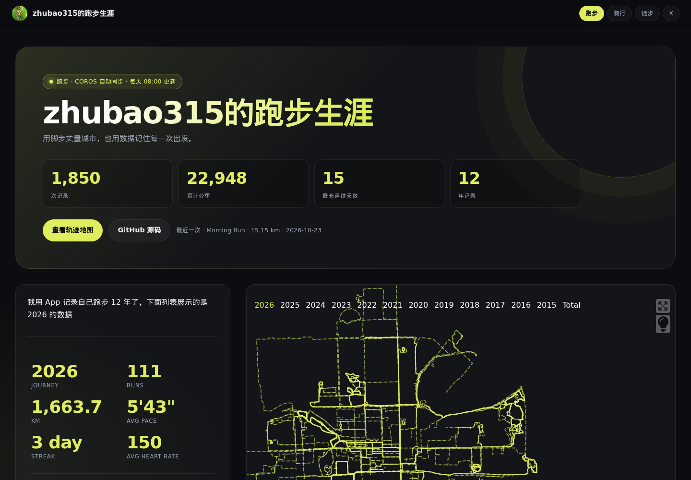

<div align="center">



# zhubao315的跑步生涯

**用脚步丈量城市，也用数据记住每一次出发。**

[](https://github.com/zhubao315/running/actions/workflows/coros_sync.yml)
[](https://zhubao315.github.io/running/)
[](https://zhubao315.github.io/running/)
[](https://github.com/zhubao315/running/commits)
[](https://github.com/zhubao315/running/blob/master/LICENSE)

[🌐 在线站点](https://zhubao315.github.io/running/) · [📊 数据概览](#数据概览) · [🔄 自动同步](#自动同步) · [🛠 本地运行](#本地运行) · [🔗 三个站点](#三个站点)

</div>

---

## 数据概览

<!-- STATS:START -->
| 记录 | 总里程 | 累计爬升 | 时间跨度 | 最近一次 |
|---:|---:|---:|---:|---|
| 2,160 次跑步 | 25,494 km | — | 2013–2026 | 2026-10-28 |
<!-- STATS:END -->

> 每天早上自动同步（约 **08:10 北京时间**）；完成后自动重建页面并部署到 GitHub Pages。

## 站点亮点

- GitHub 风格日历热力图，按年切换
- 年度 / 总里程海报与圆环图
- 单次轨迹地图、配速与心率
- 3D 地形（已烘焙 700+ 条轨迹）
- 三个运动站点互相跳转

## 自动同步


- **数据源**：COROS 官方 MCP（OAuth 2.0 + PKCE），不再依赖 Strava token
- **调度**：每天 `00:10 UTC` / `08:10 Asia/Shanghai`
- **工作流**：[`coros_sync.yml`](https://github.com/zhubao315/running/blob/master/.github/workflows/coros_sync.yml)
- **落盘**：同步结果直接提交回仓库，不依赖会过期的 Actions 缓存
- **构建**：同步 → SVG 海报 → README 数据表 → `pnpm build` → Pages

## 数据口径

只统计跑步；2013 年至今（Keep/Garmin/COROS 历史合并），2026-06 起由 COROS 自动同步。

- 轨迹来自 COROS FIT / Keep GPX 等原始文件，地图与 3D 地形均由原始点位生成
- Keep 历史数据于 2026-10-28 合并；后续由 COROS 自动增量同步
- 2026-10-28 清理了 4 条 Codoon 2024–2026 的重复/损坏记录（polyline 全为 `?`，且与同日 COROS 活动重复）
- 3D 地形是预烘焙的，只覆盖部分活动（长距离优先）
- 为控制构建体积，FIT 文件在解析后不全部入库；`data.db` 与 `activities.json` 是权威数据

## 本地运行

```bash
# 前端
pnpm install
PATH_PREFIX=/running pnpm dev
PATH_PREFIX=/running pnpm build

# 数据同步（需要 COROS 账号）
pip install -r requirements.txt
python run_page/coros_mcp_sync.py \
  --account "$COROS_ACCOUNT" \
  --password "$COROS_PASSWORD" \
  --sport running
```

可选参数：

- `--start-date 20260101`：指定补齐起点
- `--max-downloads 45`：遵守 COROS 每日 50 个 FIT 的上限
- `--min-distance-km 3`：过滤短距离活动（骑行站使用）

## 仓库结构

| 路径 | 说明 |
| --- | --- |
| `run_page/coros_mcp_sync.py` | COROS MCP 同步主脚本 |
| `run_page/gen_svg.py` | 热力图 / 海报生成 |
| `run_page/data.db` | SQLite 活动库 |
| `src/static/activities.json` | 前端数据 |
| `src/static/scenes.json` | 3D 场景索引 |
| `public/scenes/` | 预烘焙 3D 地形 |
| `.github/workflows/coros_sync.yml` | 每日同步 + 部署 |

## 相关站点

| 站点 | 内容 | 链接 |
| --- | --- | --- |
| 🏃 跑步 | 2015 至今的跑步记录 | <https://zhubao315.github.io/running/> |
| 🚴 骑行 | 2022 至今的骑行记录 | <https://zhubao315.github.io/cycling/> |
| 🥾 徒步 | 山野徒步与 3D 地形 | <https://zhubao315.github.io/hiking/> |
| ❤️ 健康 | 睡眠 / HRV / 心率 / 压力分析 | <https://zhubao315.github.io/health/> |

## 技术栈

[running_page](https://github.com/yihong0618/running_page) · React · Vite · Mapbox GL · Python · SQLite · COROS MCP · GitHub Pages

## License

MIT
